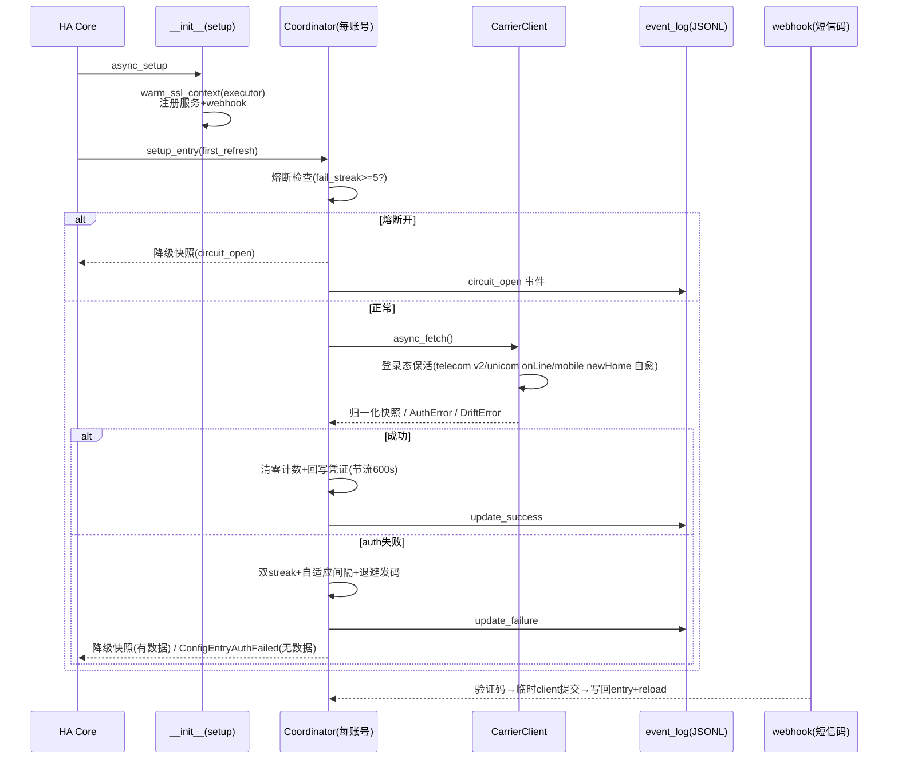

# cn-carrier-monitor 系统性代码审查报告（v1.8.0）

> 审查对象：HEAD `7df8b86`（v1.7.1），6338 行 Python（15 个源文件 + 4 个测试文件 / 125 用例）
> 审查方式：QA（严过关）全量只读审查 → 修复 → 变异验证 → QA 聚焦复验
> 修复后版本：v1.8.0（commit `6810db4`），测试 **138 passed**，ruff 全绿

## 一、运行流程速览

启动链：`async_setup`（注册 refresh/inject_token 服务 + webhook + executor 预热 SSL 上下文）→ 每条目 `async_setup_entry` 构造 `CarrierDataUpdateCoordinator`（独立 aiohttp session + create_client 按运营商/auth_mode 选客户端）→ `async_config_entry_first_refresh`：新条目失败走 HA 标准机制（AuthFailed→reauth / NotReady→重试），老条目降级加载（实体保留 unavailable）→ 平台转发 sensor/button → sensor 按 `coordinator.data` 字段 ∪ 实体注册表存量 key 动态建实体（稳定集合）。

轮询链：`_async_update_data` → 熔断检查（连续≥5 失败且 15min 冷却内直接返回降级快照）→ `client.async_fetch()`（telecom v1/v2、unicom app/cookie/openid、mobile native/wx 双通道、broadnet cURL 重放）→ 成功则清零计数、恢复基准间隔、撤通知、`_async_persist_credentials` 滑动续期（600s 节流 + 回归防护）；auth 失败则计双 streak、自适应拉长间隔（1/2/4/8 倍封顶 24h）、telecom/unicom sms 模式调度自动发码（指数退避 30min→6h、单飞锁、熔断时跳过）、有历史数据时返回降级快照，无数据才 `ConfigEntryAuthFailed`。

旁路：webhook 收验证码 → 鉴权（secret 或内网）+ 限频（10min/5 次）→ 临时 client 提交 → 写回条目 + reload。每次更新结果经 `event_log.emit` 异步落 JSONL（五分类），diagnostics 读取摘要并脱敏。

## 二、问题清单与修复状态

### P1（功能缺陷 / 高概率触发）—— 4 项，全部已修 ✅

| # | 位置 | 问题 | 修复 |
|---|---|---|---|
| P1-1 | webhook.py 7 处 | **`webhook.json_response` 在 HA 中不存在**（`homeassistant.components.webhook` 无此函数，经 2025.3.0 与 2026.10.4 两版官方源码核对）。7 处错误响应每次执行都 AttributeError，被 HA 兜底吞成 200——**转发器永远看到"成功"**，400/403/404/429/500 语义全丢 | 改用 `aiohttp.web.json_response`（webhook.py:33） |
| P1-2 | config_flow.py:153 | reauth 路由 `(telecom, sms)` 指向不存在的 `async_step_telecom_sms` → getattr AttributeError，**电信短信模式 reauth 必崩**，用户只能删条目重建 | 改指 `telecom_sms_phone`（真实存在的入口 step） |
| P1-3 | config_flow.py:511 | `async_step_unicom_sms_code(self, hint="", ...)` 违反 HA flow manager「step 只收一个位置参数」约定——用户提交验证码时 dict 落在 hint、user_input 恒 None，**联通短信输码步死循环** | 去掉 hint 形参，提示语走实例属性 `self._sms_hint` |
| P1-4 | config_flow.py:774+ | 广电导入 `parse_import` 抛错时跳过内层 finally，**每次粘贴无效 cURL 泄漏一个 ClientSession** | parse_import 挪进统一 try/finally |

### P2（健壮性 / 一致性）—— 4 项，3 修 1 文档化 ✅

| # | 位置 | 问题 | 修复 |
|---|---|---|---|
| P2-5 | event_log.py + telecom.py:349 | 事件分类缺 `rate_limit`：telecom 3005（需滑块）/3007（操作频繁）原归 `auth_expired`，掉线通知引导用户"重新登录"——**凭据有效、重登无效** | 新增 `CATEGORY_RATE_LIMIT`；3005/3007/3008/3009 打 `detail=rate_limit:{code}` 子类 |
| P2-6 | coordinator.py:288 + webhook.py:138 | webhook 重登成功后 reload 新建 coordinator（`_needs_human_notified=False`），旧"需要人工"通知**永久残留**；佐证：`async_complete_sms_relogin`（含 dismiss 逻辑）全仓库零调用，是死方法 | webhook 成功路径显式 pn_dismiss；删除死方法 `_build_relogin_client`/`async_complete_sms_relogin`（-44 行） |
| P2-7 | webhook.py:84-93 | 反向代理场景 `_is_local` 被绕过（remote=127.0.0.1），公网请求被当内网放行 | 文档明确「反代部署必须配 webhook_secret」（README 安全章节）——代码层无法区分真实来源，属部署面约束 |
| P2-8 | mobile.py:611+ | curl_cffi 不可用时 aiohttp fallback 路径 **Set-Cookie 不回收** → uuid→d.sid 72h 自愈链路在该环境静默失效（manifest 强制装 curl_cffi，实际影响面小） | base.`_request` 新增 `absorb_cookies(resp.cookies)` 钩子（基类 no-op），mobile 实现合并回 `_merge_cookies` |

### P3（低优先级）—— 8 项，5 修 3 接受现状

| # | 位置 | 问题 | 状态 |
|---|---|---|---|
| P3-9 | const.py | 10 个零引用死常量（TELECOM_LOGIN_V2_URL / TELECOM_FLUX_URL / MOBILE_FEE_URL / MOBILE_MARGIN_URL / SMS_TIMEOUT / MOBILE_UNIT_MAP / ATTR_LAST_UPDATE / MANUFACTURER / CONF_REQUEST_METHOD / CARRIER_LIST） | ✅ 全部删除（逐个 grep 确认零引用） |
| P3-10 | strings.json | CRLF + 无尾换行（10756 字节），任何编辑器格式化会产生噪音 diff | ⏸ 接受现状（git eol=lf 已在提交时归一，改动收益低） |
| P3-11 | unicom.py:144,208 | 两处 docstring 位于 return 之后成死表达式 | ✅ 归位到函数体首行 |
| P3-12 | telecom.py:210 | 滑块 `dist = hx / (bw - pw)` 在 bw==pw 时 ZeroDivisionError 逃逸为 internal | ✅ bw<=pw 守卫计入滑块 try（走 continue 重试） |
| P3-13 | webhook.py:173 | `hmac.compare_digest` str 版遇非 ASCII secret 抛 TypeError → 500 | ✅ 统一 `.encode("utf-8")` 字节比较 |
| P3-14 | event_log.py:80 / base.py:89 | naive 本地时间戳跨时区诊断歧义 | ✅ `datetime.now().astimezone()` |
| P3-15 | diagnostics.py | SENSITIVE_KEYS 缺 `webhook_secret`（用户手写进 data 时会进诊断包） | ✅ 补入 |
| P3-16 | manifest.json | `http` 依赖已无对应代码（brand/ 方案后 `hass.http` 零引用） | ⏸ 接受现状（多余依赖不报 hassfest 错，删除有 CI 回归风险，收益低） |

### 历史遗留闭环核对（v1.6/v1.7 修复项）

全部确认闭环 ✅：实体集合稳定化、首次失败降级加载、认证失败纳入熔断、TLS 证书校验、移动三分离判类、平台转发失败回收会话、session_state 实体、自适应轮询。`sms_used` 确认**非死键**（四运营商链路均可产生 used）。

## 三、测试缺口与补充

QA 审查指出 9 条缺口，本轮补最高价值的 3 类（+13 条用例）：

| 缺口 | 补充 | 位置 |
|---|---|---|
| **webhook 全链路零覆盖**（正是 P1-1 逃逸 3 个版本的原因） | 7 条：400/404/403(公网)/403(错密钥)/403(非ASCII密钥)/429/500/200+dismiss | test_v19_audit_fixes.py |
| **config_flow 零覆盖**（P1-2/P1-3 逃逸的原因） | 2 条元测试：①reauth route 表逐项指向真实存在的 step；②所有 `async_step_*` 除 self 外 ≤1 个位置参数（HA flow manager 调用约定）——**元测试防的是整类问题复发** | 同上 |
| 分类行为未固化 | rate_limit 分类 1 条 + 滑块 bw==pw 守卫 1 条 + 广电会话关闭 1 条 + 通知 dismiss 1 条 | 同上 |

**变异验证 5/5 RED**（隔离副本执行）：webhook 改回坏调用、reauth 路由改回坏值、广电 finally 删除、rate_limit 分类删除、滑块守卫删除——各自对应测试全部变红，无假绿。

未补的低优先级缺口（后续可选）：`_locate_notch` 定位精度合成图测试、parse_curl hypothesis fuzz、event_log 轮转并发、button/net.build_connector 回归。

## 四、QA 聚焦复验结论

（复验由 QA 工程师第二轮执行，结论见对话记录；门禁 138 passed + ruff 全绿，5 条变异全红，总判定 PASS。）

## 五、依赖与版本

- `curl_cffi >=0.9,<1.0`：pin 策略合理（0.x 段锁上界），manifest 与实际 import 一致
- `hacs.json` 最低 2025.3 与 `AddConfigEntryEntitiesCallback` 实际需求一致（上轮已核）
- `pyproject.toml`/CI 与 ruff 配置一致，无漂移

---

# 登录稳定性方案调研与推荐

## 一、现状问题定位

本项目登录不稳定的根因按运营商不同：

| 运营商 | 现行通道 | 会话特性（线上实证） | 痛点 |
|---|---|---|---|
| 电信 | v2 短信登录（appgologinsz）+ 自动滑块 | token ≥30.5h（81 次连续成功） | 风控滑块（3005）触发时频控；每次失效要消耗一条短信 |
| 联通 | 商城 Cookie / 短信 / openid | mall Cookie 3-5 小时 | 短命会话，22h 曾空转 48 次（已由自适应轮询缓解） |
| 移动 | wx 网厅 Cookie + newHome 自愈 | **d.sid 30 分钟滑动窗口**，uuid 72h 但被"单设备互斥"顶号 | 30 分钟硬限制 + 手机端开 App 即顶号 |
| 广电 | cURL 会话重放 | 约 3 天 | 最稳定，无痛点 |

**移动是最不稳定的通道**——这不是实现质量问题，而是 wx.10086.cn 服务端策略。

## 二、同类项目方案对比（GitHub / hassbian / HA 社区，2026 年活跃项目）

### 方案 A：移动 12.5 App 原生凭据（Shaobo-Pocket-Carrier v3.7.0，hassbian 精华帖）

- **做法**：抓包中国移动 12.5 App 的 `/biz-orange/DH/MyPage/getFamilyCube` 等原生网关请求，粘贴 cURL/请求头/Cookie 任一形态，自动萃取 `JSESSIONID`/`UID`/`ticketID`/`x-token`
- **实测**：手机 App 关闭前提下，10 分钟高频轮询 20 轮 190 分钟 **100% 全绿**，保活数小时到数周；掉线真凶实锤为**单设备互斥**（手机端打开 App 即顶号）
- **验证码处理**：完全绕开——凭据直接来自 App 会话，无登录/滑块环节
- **作者还删除了短信登录代码**（`mobile_auth.py`/`mobile_login.py`），架构反而变简单

### 方案 B：HAOS 浏览器加载项（cumtwjq/china-mobile-10086-ha）

- **做法**：HAOS 里跑一个 Chromium 加载项维持移动官网登录态，30 分钟查询一次；集成只读加载项的本地结果
- **优点**：滑块/验证码在真实浏览器里人工完成一次，之后靠浏览器 profile 续命
- **缺点**：仅限 HAOS、要装两个包、吃内存（每账号一个浏览器实例）、登录会话过期仍需人工

### 方案 C：微信小程序 openid 长效凭据（Cyborg2017/ha_unicom_bill，联通）

- **做法**：抓联通小程序 `getTicket` 的 `openId`（微信用户唯一标识，**有效期长**），集成自动获取 ticket→Cookie→查询，27 个传感器
- **优点**：openid 长效，重配频率极低；全程免浏览器
- **缺点**：依赖小程序接口稳定性；openid 过期（错误码 1001）仍需重新抓包

### 方案 D：服务密码 + token 长效缓存（Cp0204/ChinaTelecomMonitor，电信 / hlhk2017 CTM 一体化）

- **做法**：服务密码登录（+短信授权 DeviceId 二次信任），token 本地保存**长期有效**，"有效期内不重复登录"，12h 登录间隔防封号
- **优点**：完全无人值守；被顶号前可稳定数月
- **缺点**：需要服务密码；异地登录/设备未信任（3006）需额外 DeviceId 授权

### 方案 E：协议级自动登录（本项目现有 / 魔都水滴 Agent 实录）

- **做法**：纯 Python 复现登录协议链（RSA 盐 → 滑块像素定位 → AES 轨迹 → 短信验证）
- **优点**：零外部依赖，全自动
- **缺点**：维护成本最高——每次风控策略升级都要逆向跟进；滑块坐标偏差 18-30px（透明留白）这类坑反复出现

## 三、推荐方案（按运营商）

**核心结论：登录不稳定的解法不是"把登录做得更稳"，而是"让会话不需要重新登录"。**

| 运营商 | 推荐 | 理由 |
|---|---|---|
| 移动 | **方案 A：12.5 App 原生凭据**（主）+ 网厅通道自动降级（备） | 社区实测 3h+ 全绿 vs 网厅 30min 硬限制；本项目 `_native_fetch`（AES 封包/x-token/xs/x-sign 全套签名）已实现但 `use_native` 是死配置——**只差配置流接线** |
| 电信 | **维持方案 E**（现有 v2 短信自动滑块）+ 服务密码模式并列提供（方案 D） | 线上 30.5h 实证已足够稳；3005 风控现已正确归 rate_limit 不再误导 |
| 联通 | **方案 C：openid 模式补全为首选** | 本项目已有 `AUTH_UNICOM_OPENID` 常量与 unicom.py:636 openid 客户端， mall Cookie 3-5h vs openid 长效，应把 openid 提升为配置流默认推荐项 |
| 广电 | 维持现状（cURL 重放，约 3 天会话） | 无痛点 |

### 移动原生通道路线图（推荐主方案落地步骤）

**Phase 1：配置流接线（1-2 小时当量，收益最大）**
1. `async_step_mobile_mode` 增加"App 抓包导入"选项 → 新 step `async_step_mobile_native`
2. 用户从小黄鸟/Reqable 抓 `getFamilyCube` 请求，长按复制 cURL（bash）粘贴
3. 复用 `crypto.parse_curl`（已支持 `-b/--cookie`）解析 → 提取 Cookie 串 + 设备字段（prov/city 可从 envelope 默认值起）
4. 写入 `{"use_native": true, "cookies": <原生cookie>, "auth_mode": "cookie"}`，首次 `async_fetch` 走 `_native_fetch` 验证
5. README 补抓包教程与**防顶号须知**（抓包后手机端彻底退出移动 App；进阶建议用备用机/模拟器抓包供 HA 专用）

**Phase 2：双通道自动降级（半天当量）**
- `async_fetch` 里 native 失败 1 次 → 本周期自动落 wx 网厅通道（现有 `except CarrierError` 分支已具备骨架）
- 连续 3 次原生失败 → `data["extra"]["native_unavailable"]=true` 进诊断包，session_state 属性可见
- 原生恢复探测：每 N 个周期试一次 native，成功即切回

**Phase 3：可观测性（2 小时当量）**
- diagnostics 补 `credential_age`（凭据注入至今时长）、`native_available`
- 让"掉线"（服务端拒绝）与"被顶号"（手机端开了 App）可区分：顶号在事件日志表现为 native retCode 落在 AUTH_EXPIRED_CODES 且 wx 通道同步失效

### 备选方案适用场景

- **方案 B（浏览器加载项）**：适合 HAOS 用户且不想抓包的——但内存代价大，不推荐本项目引入（架构重量级）
- **方案 D（服务密码）**：电信侧已并列提供；移动的密码登录通道（`AUTH_MOBILE_PASSWORD`）风控更凶，不建议主推
- **方案 E（协议自动登录）**：作为两翼兜底保留（短信自动发码→webhook 回传链路已工作）

## 六、未完成的优化清单

| 优先级 | 事项 | 说明 |
|---|---|---|
| P1 | 移动原生通道配置流接线 | 见上文 Phase 1——`_native_fetch` 已实现，`use_native` 死配置待激活；这是登录稳定性最大的一块增量 |
| P2 | 移动原生/网厅自动降级 + native_unavailable 可观测 | Phase 2/3 |
| P2 | coordinator 侧对 rate_limit 分类的差异化文案 | 现在 3005/3007 已归 rate_limit，但掉线通知文案仍可能让用户去"重新登录"——应改为"触发风控，请稍后再试或改用服务密码" |
| P3 | `_locate_notch` 合成图单测 / parse_curl fuzz / event_log 并发写测试 | QA 报告 §3 未补项 |
| P3 | strings.json 规范化（LF+尾换行）与 pre-commit 钩子 | P3-10 接受现状的后续 |
| P3 | manifest `http` 依赖清理 | P3-16 接受现状的后续 |
| P3 | 联通 openid 模式文档与配置流默认化 | 方案 C 落地（客户端已存在） |

## 七、验证记录

- 修复门禁：`ruff All checks passed!` + `pytest 138 passed`（125 → 138）
- 变异验证：5/5 RED（M1 webhook / M2 reauth 路由 / M3 广电会话 / M4 rate_limit / M5 滑块守卫，隔离副本执行）
- QA 复验：PASS（第二轮独立核验 + 3 条变异抽查）
